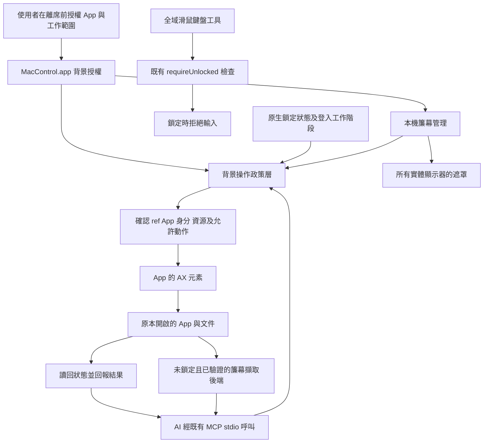

# iMac 離席背景操作與簾幕模式設計

我們提供兩種可分別選用的本機功能：保留 macOS 原生離席鎖定的背景操作，以及遮住實體顯示器內容的簾幕模式。AI 主要透過指定 App 的 Accessibility 元素或程式介面處理工作。App、文件和登入狀態都留在目前的桌面；這項設計不使用 VM、Docker、另一台電腦或遠端桌面服務。

第一個驗證對象是現有的 `mac_ax_action`。它可以直接要求指定元素執行動作，適合評估不依賴全域滑鼠鍵盤的背景操作。不過，「工具目前主動拒絕鎖定狀態」和「macOS／App 是否接受鎖定時的 AX 操作」是兩件事。我們必須先通過實機驗證，才為個別 App 開放能力；簾幕的顯示覆蓋與擷取也有獨立驗證門檻。本設計尚未代表功能可用。

> **目前實作狀態（2026-11-10）**：本分支已加入本機簾幕 MVP，包括每部顯示器的黑色遮罩、本機快捷鍵 `Control-Option-Command-F12`、原生鎖定時隱藏遮罩並在解鎖後重新覆蓋，以及簾幕狀態與 MCP 輸入限制。簾幕啟用時保留未鎖定的 AX 操作；原生鎖定下的 `mac_ax_action` 仍由 `requireUnlocked()` 拒絕。實機鎖定測試中，TextEdit 的 AX 樹在鎖定後不再包含文件欄位，鎖定前的欄位 ref 執行 `mac_ax_action` 回傳 `STALE_REF` 且 `delivered:false`；原始 AX 呼叫未能獨立驗證。簾幕的實機畫面覆蓋仍待快捷鍵驗證。

## 使用需求與範圍

- iMac 保持清醒，使用者可正常按 Control＋Command＋Q 離席鎖定。
- AI 操作原本登入的同一個桌面及已開啟的 App，不建立另一份工作桌面。
- 原生鎖定模式下，實體螢幕維持系統鎖定畫面，回座後仍由 macOS 驗證身分。
- 背景模式不解鎖、不輸入解鎖密碼、不啟動前景鍵鼠操作，也不自動處理系統權限提示。
- AI 使用文字、元素屬性及動作結果確認進度，不要求取得被鎖住桌面的即時影像。
- 只有已驗證的 App、資源和動作可以執行；不支援的步驟暫停，保留給使用者解鎖後處理。
- 簾幕模式遮蔽 iMac 內建及所有已連接的實體顯示器；它提供畫面隱私，不宣稱阻止現場的人操作電腦。

這個範圍提供「已授權工作在鎖定後繼續」的能力，無法保證任意 App 都能像一般桌面控制一樣操作。畫布、遊戲、必須前景互動的控制項，以及系統認證介面，不列入第一版。

## 模式選擇

鎖定狀態與簾幕狀態分開記錄。簾幕不能把 `screen_locked` 改成 false，也不能把原本需要密碼的鎖定降級成遮罩。

| 使用狀態 | 實體顯示器 | AI 操作方式 |
| --- | --- | --- |
| 原生鎖定 | macOS 鎖定畫面 | 僅限已驗證的背景 AX／App API；不送全域鍵鼠輸入 |
| 未鎖定且開啟簾幕 | 本機黑色遮罩，原桌面繼續運作 | 第一版優先使用授權 AX 操作；擷取排除遮罩的畫面須另外驗證 |
| 原生鎖定且簾幕已啟用 | 系統登入／鎖定畫面優先，桌面遮罩保留 | 和原生鎖定相同；解鎖後先保留遮罩，等本機使用者恢復畫面 |

原生鎖定下不可用的 AX 動作，不會自動改成「未鎖定＋簾幕」。切換到未鎖定狀態仍由使用者親自完成。

## 本機簾幕模式

主要設計是在 MacControl.app 管理的每部實體顯示器上建立不透明的遮罩視窗。這些視窗只負責顯示黑色背景及簡短狀態，不取得 App 的鍵盤焦點，也不偽裝成 macOS 登入視窗。一般 App 的遮罩無法取代系統安全邊界；強制結束遮罩程序、系統視窗及顯示器切換都可能影響遮蔽。

### 顯示與操作

`CurtainCoordinator` 管理顯示器清單、遮罩視窗、當前授權及狀態。遮罩必須覆蓋整個顯示範圍，包含選單列和 Dock 所在區域；Spaces、全螢幕 App、解析度變更、鏡像及新增顯示器都列為驗證項目。無法確認目前顯示器集合已覆蓋時，先暫停 AI，不回報簾幕正常。

第一版在簾幕下優先使用 AX，避免依賴座標輸入。若後續支援滑鼠，必須驗證遮罩不攔截事件，例如使用 AppKit 的 [ignoresMouseEvents](https://developer.apple.com/documentation/appkit/nswindow/ignoresmouseevents)。這也會讓實體滑鼠有機會操作底下的 App，因此不能把此設定宣稱為本機鍵鼠鎖定。

現有 `appAt`／`requirePoint` 使用 Accessibility 命中測試確認游標下的 App。簾幕不能成為跳過此檢查的理由；若無法確認實際接收輸入的 App，座標工具維持拒絕，繼續使用已授權 AX 動作。新增簾幕也不放寬現有前景、視窗身分及陳舊截圖檢查。

### AI 看見的內容

AX 文字及元素狀態是預設觀測方式。有影像需求時，另外使用 ScreenCaptureKit 的 [SCContentFilter](https://developer.apple.com/documentation/screencapturekit/sccontentfilter) 排除本程式建立的簾幕視窗，讓 AI 有機會取得其後的原桌面內容；實際覆蓋下的更新與擷取必須通過實機驗證，不能只依 API 形式推定。

目前 `mac_screenshot` 使用 `/usr/sbin/screencapture` 擷取主顯示器，不能直接假定它在簾幕下仍回傳原桌面。簾幕擷取路徑必須辨識本程式及其程序啟動身分，僅排除登記的遮罩視窗，並保留原本使用者選擇的擷取範圍；排除遮罩本身不代表縮限為單一 App。切換模式、更新遮罩或變更顯示器後，清除上一張截圖的座標資訊，取得新影像後才允許座標工具。

擷取失敗或無法確認影像更新時，保留遮罩，回報影像不可用。不能以暫時關閉簾幕、重用舊影像或回傳黑圖為由繼續執行視覺任務。螢幕錄影第一版先不在簾幕下提供，避免沿用不相容的擷取路徑。實體螢幕遮蔽不會阻止已授權畫面或 AX 內容交給 AI，也不涵蓋音訊隱私。

### 開啟與恢復流程

1. 使用者在 MacControl.app 開啟簾幕，選擇本次允許的工作及 App。第一次使用時，先完成必要權限及本機相容性驗證。
2. 暫停輸入，建立所有遮罩並確認目前顯示器覆蓋狀態。若使用影像，再確認擷取後端可用，清除舊座標後恢復工作。
3. AI 工作完成或連線結束時，停止後續操作，預設保留簾幕。AI 沒有自行解除遮蔽的工具權限。
4. 使用者透過預先設定的本機取回入口要求恢復。先暫停 AI、取消排隊操作，再由使用者確認恢復畫面；若原生鎖定仍有效，使用正常的 macOS 解鎖方式。
5. 模式、顯示器或授權改變後重新取得狀態及快照，不能延用先前的座標或操作許可。

取回入口必須在所有顯示器被遮蔽時仍可使用，例如本機快捷鍵開啟恢復面板；不得只依賴被遮住的選單列。它不能被一般 AI 按鍵誤觸後直接拆除遮罩，也不能攔住 macOS 的正常鎖定、解鎖或系統認證介面。原生鎖定有效時先由 macOS 正常解鎖，App 的取回入口不接管登入視窗。

### 簾幕狀態與失敗

狀態使用 `off`、`preparing`、`active`、`paused`、`fault`，並另外回報 `screen_locked`、顯示器清單及影像擷取能力。`active` 表示目前登記的遮罩已就位，不代表具備原生鎖定強度或可證明沒有任何影格外洩。系統鎖定時仍由原生鎖定規則決定 AI 能力，不因簾幕狀態而放寬。

遮罩失效或覆蓋未知時停止所有 AI 操作，嘗試保留仍存在的遮罩；只有影像擷取失效時則暫停視覺工作，已有授權且可讀回確認的 AX 工作仍可執行。若使用者事先選擇遮蔽失效時鎖定，透過經驗證的系統鎖定流程提出請求，讀回鎖定成功後才移除遮罩。正常退出 App 也先完成鎖定交接，或由本機使用者明確選擇恢復畫面。若遮罩程序突然崩潰，桌面可能在鎖定完成前露出，因此不能承諾這條回復路徑保證零外洩。需要離席安全保護時仍選原生鎖定。

### 原生旁白簾幕的定位

Apple 的 [VoiceOver 螢幕簾幕](https://support.apple.com/zh-tw/guide/voiceover/vo2726/mac) 可以讓畫面變黑，但依賴「旁白」，關閉旁白也會關閉簾幕。它可列為既有 VoiceOver 使用者的相容性後端候選；本設計不自動更改使用者的旁白設定，也不把送出切換快捷鍵當成已確認開啟。是否能可靠查詢狀態及配合現有擷取方式，須另行驗證。

因此產品的「簾幕模式」先以可由本程式管理狀態的本機遮罩設計，不宣稱它等同 Apple Remote Desktop 的簾幕或 macOS 原生鎖定。

## 現有程式的邊界

以下位置以原始碼版本 `5245105b1d8e5380e0bdcf08b3043e7755ee990f` 為準。

| 元件 | 現有行為 | 設計上的處理 |
| --- | --- | --- |
| [SessionLock.swift](../Sources/MacControl/SessionLock.swift) | 無登入工作階段、鎖定或其他使用者佔用顯示器時，回傳輸入阻擋原因 | 保留現有全域輸入限制；另外判定背景操作所需的同一使用者工作階段 |
| [MacControl.swift](../Sources/MacControl/MacControl.swift) 的 `axAction` | 約第 2052 行呼叫 `requireUnlocked()`，之後才送出 AX 動作 | 保留預設路徑，新增明確且受限制的背景路徑 |
| 同檔的 `uiTree`、`find`、`wait` | 有依 App 讀取元素的路徑；這不構成鎖定時可讀的實測證據 | 驗證鎖定後讀取及結果確認是否有效，再提供給背景模式 |
| [RefRegistry.swift](../Sources/MacControl/RefRegistry.swift) | ref 綁定元素、PID、程序啟動時間與快照 | 沿用身分檢查；背景授權另綁定 App、資源及本次工作階段 |
| [SharedLock.swift](../Sources/MacControl/SharedLock.swift) | 既有輸入共用鎖防止多個伺服器交錯操作 | `mac_ax_action` 的背景變更也必須取得同一把鎖 |
| [Failure.swift](../Sources/MacControl/Failure.swift) | 回報 `delivered` 與 `retry`，區別未執行及結果未知 | 背景模式沿用語意，不把逾時當成「完全沒執行」 |
| `MacControl.swift` 的 `screenshot`、`appAt`、`requirePoint` | 使用主顯示器擷取及 AX 命中測試保護座標輸入 | 簾幕新增擷取後端；保留輸入接收者確認，無法確認時停用座標工具 |

Apple 文件定義了 [AXUIElementPerformAction](https://developer.apple.com/documentation/applicationservices/1462091-axuielementperformaction)，但沒有保證所有 App 在螢幕鎖定時都接受動作。鎖定時的可用性是每個背景後端的驗收條件。

## 控制架構

我們增加一個背景操作政策層，讓同一個 MCP 工具可以選擇受限制的 AX 路徑。全域鍵鼠工具繼續使用現有鎖定檢查。



這條背景路徑不對登入視窗送出輸入，也不把 `screen_locked` 改成 false。它只在 macOS 和目標 App 仍允許程式介面操作時執行。若 OS 拒絕，就回報限制，不轉用其他輸入方式繞過。

## 原生鎖定的使用者流程

1. 使用者在 MacControl.app 選擇允許的 App、文件或視窗、可執行動作及本次工作的有效時間。MVP 先要求 MacControl.app 保持運作；關閉後撤銷背景授權。
2. 在仍未鎖定時完成必要的 Accessibility 權限。若未來加入 Apple Events 後端，其 Automation 權限也在此時由使用者處理。
3. App 顯示本機已驗證的背景能力。尚未驗證的 App 不顯示為可用，讀取成功也不代表變更動作已通過。
4. 使用者照平常方式按 Control＋Command＋Q。工具確認同一使用者仍登入、螢幕已鎖定，才允許本次背景工作。
5. AI 讀取目標元素，使用回傳的 ref 執行已授權動作，再讀回狀態確認結果。
6. 任務完成、授權到期、App 重新啟動或發生需要使用者介入的情況時，停止後續動作。iMac 保持原生鎖定。
7. 使用者回到座位，直接使用 macOS 原本的方式解鎖。偵測解鎖後撤銷本次背景授權，讓人接手；若同時啟用了簾幕，保留遮罩直到本機使用者要求恢復。

正常解鎖不依賴 MCP 或 MacControl.app 存活。這是保留原生鎖定的重要收益。

## 工具介面

優先擴充既有工具，避免 AI 必須學習另一整套桌面控制介面。下列欄位都是提案，尚未加入目前的 schema。

| 工具 | 提案 |
| --- | --- |
| `mac_status` | 保留 `screen_locked` 的既有語意，新增 `background_control` 及獨立的 `curtain` 狀態，列出授權、能力及需要使用者處理的原因 |
| `mac_curtain_status` | 新增唯讀查詢，回傳狀態、顯示器覆蓋、擷取能力及停止原因；第一版的開啟／恢復由 App 本機入口處理 |
| `mac_ui_tree`、`mac_find`、`mac_wait` | 提供明確的 `background`／`curtain` 讀取模式；必須指定 bundle ID，限制在授權資源內，依實測能力回傳文字與元素狀態 |
| `mac_ax_action` | 新增選填的 `mode`，預設 `standard`；`background` 使用鎖定下的授權路徑；`curtain` 使用未鎖定且遮罩正常的授權路徑。兩者都必須指定 App 及有效 ref |
| `mac_screenshot` | 原生鎖定時不作為背景觀測後端；未鎖定的簾幕模式可使用已驗證的 ScreenCaptureKit 路徑，不把鎖定畫面、遮罩或舊影像當成 App 最新狀態 |
| `mac_record_start` | 第一版不在原生鎖定或簾幕模式下啟動錄影 |
| `mac_mouse`、`mac_scroll`、`mac_key`、`mac_type_text`、變更視窗的 `mac_window` | 鎖定時維持拒絕；背景路徑不呼叫它們 |

例如，以下是未來可能接受的呼叫，並非現在可直接使用的參數：

```json
{
  "app": "com.example.App",
  "mode": "background",
  "ref": "k3f9q2.12",
  "action": "set_value",
  "value": "本次工作產生的內容"
}
```

`mode` 只表達執行方式，不能建立授權。授權只由使用者離席前在 App 中建立，綁定本次 MCP 連線及選定資源；模型不能透過工具擴大範圍或延長期限。第一版採 App 模式，暫不提供可從任意 CLI 自行開啟背景權限的入口。

簾幕啟用時，所有受管理的 MCP client 都必須遵守目前模式、授權與共用鎖，不能由另一個 client 繞過暫停狀態。`curtain` 模式遇到原生鎖定立即停止該路徑；只有另行授權且已驗證的 `background` 路徑可以接手，不能自動切換。

## AX 動作的准入規則

我們先驗證可以讀回結果的簡單操作，例如一般文字欄位的 `set_value`，以及指定核取方塊的 `check`／`uncheck`。`press` 必須確認目標按鈕及其實際後果，才加入該 App 的能力清單。`focus`、啟用 App、模擬按鍵及移動視窗不屬於背景模式。

`background` 動作依序檢查：

1. 本次背景授權仍有效，App 及指定資源在範圍內。
2. 使用者仍在同一登入工作階段，螢幕仍鎖定；未知狀態、登出及快速使用者切換都停止工作。
3. bundle ID、程序身分、PID 啟動時間及 ref 都吻合。App 重開後的相同名稱或 PID 不能繼承舊授權。
4. 目標不是登入、密碼、系統認證或權限設定介面，動作在已驗證的能力清單內。
5. 取得既有共用輸入鎖後，再次檢查授權及工作階段，才送出 AX 請求。
6. 讀回預期的值、選取狀態或文件狀態，回報是否已執行及是否已確認。

`curtain` 的 AX 動作沿用相同的 App、資源、ref、共用鎖及結果確認要求；第 2 項改為「原桌面未鎖定、目前所有顯示器的遮罩正常」。原生鎖定或簾幕覆蓋狀態未知時，這條路徑停止；不能只憑 `mode` 參數略過狀態檢查。

背景動作使用的 ref 不跨越本次授權、鎖定／解鎖或程序重新啟動。既有快照身分可以沿用，但背景模式必須額外檢查這些生命週期。

AX 回覆成功只證明呼叫被接受，不能單獨證明任務完成。Apple 也指出 AX 逾時可能發生在 App 已進行動作之後，因此結果未知時先讀回，不能盲目重送。不可逆或對外動作仍受原任務及使用者指示限制；背景授權本身不擴大任務範圍。

## 授權與生命週期

MacControl.app 持有短期背景授權，MCP helper 經本機 IPC 取得範圍內的操作許可。實作時優先使用 XPC，核對呼叫端的程序憑證、同一使用者及已配對 helper 身分，不以 caller 自報的名稱或單一 PID 當作授權依據。這不新增網路監聽埠或系統管理員 daemon。

授權只保留在記憶體。App、helper 或 MCP 連線重新啟動後必須重新授權。多個 client 的工作保持隔離，不能借用其他連線的 ref 或背景許可。網頁、文件中的文字只是工作資料，不能產生政策變更。工作授權失效會停止 AI，不會單獨觸發簾幕解除；遮罩生命週期另由本機使用者或已確認的鎖定交接管理。

這項功能保護的是使用者離席時的本機畫面及輸入邊界。它不對已取得同一帳號任意執行權的惡意程式提供新的隔離保證；若使用者另行授權 `host_exec`，其權限仍需獨立管理。背景 AX 路徑不使用 `host_exec` 當作失敗時的替代工具。

## 失敗與取回控制

| 情況 | 處理 |
| --- | --- |
| 權限不足或出現新權限提示 | 停止該工作，回報 `retry: user`，由使用者解鎖後處理 |
| AX 不支援、鎖定後無法讀取或目標需要前景互動 | 回報背景能力不可用，不轉為鍵鼠操作 |
| App 當機、重開、ref 失效或文件更換 | 廢止相關 ref 及操作許可，重新讀取；程序重開需要重新授權 |
| AX 逾時且結果不明 | 回報 `delivered: unknown`、`retry: check`，讀回後才決定後續動作 |
| 使用者解鎖、切換帳號或登出 | 撤銷授權、取消排隊動作；已送入 App 的請求可能仍完成，必須如實回報 |
| App、helper 或 AI client 結束 | 取消後續工作；原生鎖定不依賴這些程序，因此仍由 macOS 維持 |
| 簾幕模式下擷取失效 | 保留遮罩，回報影像不可用；僅在已有授權且 AX 仍可驗證時繼續非視覺工作 |
| 簾幕覆蓋未知、顯示器變更或遮罩失效 | 暫停所有 AI 操作，重建覆蓋；依事先設定請求原生鎖定，不宣稱突然崩潰時可保證畫面不外洩 |
| 要求恢復簾幕畫面 | 先停止 AI，再由本機使用者恢復；不移除仍有效的 macOS 鎖定 |

取消不是回復已發生的修改。操作紀錄保留時間、App、動作種類、執行與確認狀態，預設不保存完整文件文字、密碼、截圖或輸入內容。

## 實機驗證門檻

第一階段只做能力驗證。先用使用者同意的測試文件及明確目標，完成下列項目，再決定第一版支援哪些 App。一般 macOS API 文件及未鎖定時的測試都不能代替這些檢查。

| 驗證 | 通過條件 |
| --- | --- |
| 鎖定後讀取 | 原生鎖定保持有效，指定 App 的元素及必要狀態仍可讀取 |
| 鎖定後變更 | 修改測試文字或核取狀態後，可從同一元素讀回；沒有送出 CGEvent 或啟用 App |
| 實體螢幕與本機輸入 | 由現場觀察確認操作期間持續顯示系統鎖定畫面，正常鍵鼠不能進入原桌面 |
| 動作對象 | 原本 App、原本文件的內容改變，其他文件及認證介面未被操作 |
| 解鎖與生命週期競態 | 解鎖、撤銷、登出、程序重開及 ref 過期後，不接受新的背景操作 |
| 失敗語意 | App 無回應、模態視窗或逾時不造成盲目重試，不宣稱已完成未確認的動作 |
| 程序退出 | 結束 App／helper／client 後，iMac 仍保持原生鎖定，使用者可照常解鎖 |
| 多 client | 不發生交錯修改、ref 混用或授權移用 |
| 簾幕覆蓋 | 現場確認內建及外接顯示器、Spaces、全螢幕 App、選單列與 Dock 均符合遮蔽需求；新增顯示器會暫停 AI |
| 簾幕下 AX 與影像 | 原本 App 可透過 AX 操作並讀回；影像後端能取得持續更新且未混入遮罩的內容，否則只提供 AX 能力 |
| 簾幕座標與輸入 | 模式及顯示器變更後舊座標失效；不能確認底下 App 時，滑鼠工具拒絕輸入 |
| 簾幕取回與故障 | 所有畫面遮住時仍可使用本機取回入口；AI 先停止，正常退出先確認鎖定交接，崩潰外洩風險如實記錄 |
| 簾幕與原生鎖定組合 | 開關簾幕不解除原生鎖定；解鎖先撤銷背景授權並保留已開啟的遮罩 |

能力紀錄至少包含 macOS 版本、App 版本、後端、動作及測試結果。App 或 OS 更新後先重新驗證受影響能力；無法確認相容性時停止提供該背景動作。fixture 通過只證明機制可用，還要驗證實際要操作的 App。

如果 AX 在指定 App 鎖定後失效，第二階段才評估該 App 的原生 Apple Events／API。只提供固定動作及結構化參數，不讓模型提交任意 AppleScript、`System Events` 按鍵腳本或 shell。可參閱 [Apple 的腳本字典說明](https://support.apple.com/guide/script-editor/about-script-editor-scpedt6935/mac)。

瀏覽器若需要 DOM 操作，可另設計已登入原分頁的擴充功能後端，按分頁及網域授權，經 [Native Messaging](https://developer.chrome.com/docs/extensions/develop/concepts/native-messaging) 與本機程式通信。這仍需獨立驗證鎖定時的行為，不是第一版必須新增的元件。

## 實作順序

**能力驗證階段**先確認「鎖定後 AX 讀取、變更、讀回、實體畫面維持鎖定」是否在目標 App 成立。若不成立，保留原有拒絕行為，列出需要 App API 或使用者解鎖的步驟，不展開通用背景控制。

**第一版整合**增加背景授權、政策判斷及 `mac_ax_action` 的明確模式，只開放已通過驗證的 App／動作。保留現有全域輸入檢查、共用鎖、程序身分及失敗語意。先確保單一 App 的完整流程，再增加支援範圍。

**後續擴充**依實際工作需要加入 App 原生 API 或瀏覽器 DOM 後端。每個後端都必須遵守相同的資源授權、生命週期及結果確認要求。

**簾幕功能**可獨立驗證與交付：先完成全顯示器遮罩、本機取回、模式切換及 AX 操作；影像擷取通過後才增加簾幕下的截圖能力。座標輸入與錄影另外驗證，不因遮罩可顯示就視為已支援。此功能不以前述鎖定 AX 驗證成功為前提，也不以改變原生鎖定來補足能力。

預計變更集中在 `MacControl.swift`、`SessionLock.swift` 的背景狀態分類、`RefRegistry.swift` 的授權生命週期，以及 App 的授權 UI／本機 IPC。背景政策及後端應分檔，避免把例外分散到各個輸入工具。保留 `sessionInputBlockReason` 對現有鍵鼠呼叫的判斷，不能把它的鎖定回傳值全域改為允許。

簾幕另外新增 `CurtainCoordinator`、遮罩視窗及 ScreenCaptureKit 擷取後端，並擴充快照資訊以綁定模式、顯示器及遮罩版本。App 的授權頁提供模式選擇、開啟簾幕與本機恢復入口；操作流程只顯示使用者需要的狀態，不暴露 IPC 或後端細節。

政策測試應涵蓋未授權、錯誤 App、過期 ref、已解鎖及未知工作階段等拒絕路徑，並由現有 `scripts/ci.sh` 執行；鎖定桌面測試另採人工啟動，不放進日常 CI 自動鎖住使用者電腦。文件、App UI 及工具說明都應把「已驗證可背景操作」與「一般桌面控制」分別標示。
